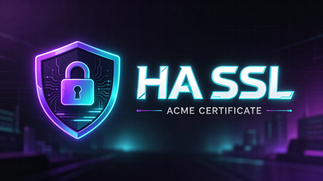

<div align="center">



# HA SSL

在 Home Assistant 内部完成 **Let's Encrypt 证书签发、HTTPS 启用、自动续期**，并把 **DDNS** 一起接管。
不需要加载项，也不要求宿主机能解析 DNS。

[](https://github.com/hacs/default)
[](https://github.com/RockJesus/ha-ssl/releases/latest)
[](https://github.com/RockJesus/ha-ssl/actions/workflows/hassfest.yml)
[](https://github.com/RockJesus/ha-ssl/actions/workflows/hacs.yml)
[](https://github.com/RockJesus/ha-ssl/actions/workflows/selftest.yml)
[](https://github.com/RockJesus/ha-ssl/actions/workflows/privacy.yml)
[](LICENSE)

<a href="https://my.home-assistant.io/redirect/hacs_repository/?owner=RockJesus&repository=ha-ssl&category=integration">
  
</a>
<a href="https://my.home-assistant.io/redirect/config_flow_start/?domain=ha_ssl">
  
</a>

</div>

## 为什么用它

官方 Let's Encrypt 加载项靠宿主机 DNS 查 `_acme-challenge.<域名>` 的 SOA 定位 zone，DNS 被路由器或运营商劫持时直接 `SERVFAIL`，镜像也常拉不下来。
本集成改用服务商 API 定位 zone、写 TXT 记录，全程绕开宿主机 DNS。

## 安装

1. **装集成**：HACS → 搜索 **HA SSL** → 下载 → 重启（也可添加自定义仓库 `https://github.com/RockJesus/ha-ssl`，类别选 Integration）。
2. **添加集成**：设置 → 设备与服务 → 添加集成 → **HA SSL** → 选 DNS 服务商 → 填凭据。
3. **等它做完**：签发证书 → 写入 HTTPS 配置 → 发通知由你重启 → 之后每 6 小时巡检、到期前自动续期。

完成后改用 `https://<域名>:8123` 访问，手机 App 里的服务器地址同步改成 https。

## 支持的 DNS 服务商

| 服务商 | 需要填 | 最小权限 |
|---|---|---|
| 阿里云云解析 | AccessKey ID + Secret | RAM 子账号授予 `AliyunDNSFullAccess`，或只给该域名的解析读写 |
| 腾讯云 DNSPod | Token ID + Token | 账号设置 → API 密钥创建，需能管理该域名 |
| Cloudflare | API Token | `Edit zone DNS` 模板，Zone 限定到该域名 |

域名默认取 HA 自己的 `external_url`/`internal_url`，留空即可；没有邮箱字段。凭据只存在 HA 本地 `.storage`，建议用最小权限子账号并定期轮换。

## 自动完成的事

| 阶段 | 行为 |
|---|---|
| 签发 | dns-01 验证，自动写入再删除 `_acme-challenge` TXT 记录 |
| 启用 HTTPS | 写入当前 HA 版本真正读取的 HTTP 配置（2026.11+ 是 `.storage/http`；没有该存储的旧版只发通知，给出你要自己加进 `configuration.yaml` 的两行，集成不改写用户 YAML） |
| 确认 | 重启后探测本机 TLS，通了就固化配置（避免 5 分钟自动回退），并把 `external_url` 切成 `https://` |
| 续期 | 每 6 小时检查一次，剩余 ≤30 天自动重签；成功后发通知，由你决定何时重启 |

签发、启用、续期各发一条持久通知，写明改了哪些 HTTPS 设置（证书路径、私钥、端口、TLS 档位）和重启后该访问的地址。**集成内没有任何自动重启调用。**

## 动态域名（可选）

首次配置时凭据校验通过后会多出一步「动态 DNS（可选）」；之后进 **选项** → 打开「启用动态域名解析」，在记录清单里每行写一条 `名称 | 类型 | 值`：

```text
dyc.example.com  | A     | auto
dyc.example.com  | AAAA  | auto
home.example.com | CNAME | other.example.com
example.com      | TXT   | v=spf1 -all
```

- `A`/`AAAA` 的值填 `auto` 跟随本机公网地址，也可填固定地址；`CNAME` 填目标主机名；`TXT` 填内容。
- 名称可写完整域名，也可写短标签（如 `home`）自动挂到主记录所在 zone；TTL 默认 600 秒。
- **记录类型按「期望状态」对账**：勾了哪种就维护哪种，没勾的类型会把云端同名旧记录删掉；`A` 和 `AAAA` 都不勾时，这两类记录会一起从云端清除（该域名就没有地址记录了），操作前想清楚。
- 每类记录独立对账，一条失败不影响其他条；地址变化、删除记录或更新失败都会发通知并触发 `ha_ssl_ddns_changed` 事件。
- 检测到运营商级 NAT（`100.64/10`）会直接报错——那种情况改 DNS 也没用。
- 「DDNS 自动同步」开关（仅启用 DDNS 时出现）控制是否自动写云端：开着时公网地址一变就写；关掉后只检测并提醒，需要点「立即同步 DDNS」按钮才落盘。

## 实体与服务

| 类型 | 实体 |
|---|---|
| 传感器 | 证书到期时间、剩余天数、公网 IPv4、公网 IPv6、DDNS 记录（每条受管记录一个实体，值为 `域名+类型+http/https`） |
| 二进制传感器 | 证书异常 |
| 按钮 | 立即签发证书、同步到HA-HTTP设置、立即同步 DDNS（仅启用 DDNS 时出现） |
| 开关 | 证书自动续期、DDNS 自动同步（仅启用 DDNS 时出现） |

| 服务 | 用途 |
|---|---|
| `ha_ssl.renew` | 立刻签发/续期一次，`force: true` 忽略「证书仍健康」判断 |
| `ha_ssl.update_ddns` | 立刻对账：勾选的 A / AAAA / CNAME / TXT 写入当前值，未勾选的 A/AAAA 从云端删除；自动同步关闭时也强制写入 |
| `ha_ssl.verify_cert` | 私钥匹配、链完整性、SAN、剩余天数 |
| `ha_ssl.configure_https` | 写入 HTTPS 配置并通知重启（管理员） |
| `ha_ssl.promote_https` | 固化待生效配置，取消自动回退（管理员） |
| `ha_ssl.probe` / `ha_ssl.diagnose` | ACME 目录连通性、本机 http/https 自检、zone 与证书体检（管理员） |
| `ha_ssl.backup_cert` / `ha_ssl.restore_cert` | 证书备份与恢复；路径受允许范围限制，拒绝 `www`（`/local/` 免认证可下载）（管理员） |
| `ha_ssl.purge` | 移除 HTTP 配置里的证书并删除证书/账户密钥/备份，需 `confirm: true`（管理员） |

会改 HTTP 配置、读写私钥或删文件的服务注册为管理员服务，非管理员账号调用会被拒绝。

## 常见坑

- 一张证书可覆盖多个域名或泛域名，但所有域名必须由**同一个** DNS 服务商托管（签发时只用一个凭据）。
- 8123 上 TLS 后明文 `http://` 立刻失效。家里 Wi-Fi 用域名访问需要路由器支持 NAT 回环；不支持就在内网用 `https://<IP>:8123` 并单独处理信任。
- 证书目录默认 `/config/ssl`，**不是** `/ssl`——后者是加载项的挂载路径。
- Let's Encrypt 同一组域名 168 小时内最多 5 张证书。集成默认复用仍健康的证书；撞上限流会把重签时间写入 `retry_after`，到点前不会重复下单。

## 开发与发布

| 工作流 | 作用 |
|---|---|
| Hassfest | 官方集成校验：manifest、文件结构、翻译、services |
| HACS Action | HACS 发布物校验：仓库结构、`hacs.json`、集成元数据 |
| ACME Self Test | 假 ACME 服务器跑通「下单 → authz → dns-01 → finalize → 下载」 |
| Privacy Scan | 脱敏扫描：工作区 + 完整 git 历史，命中即红 |

```bash
python3 scripts/check_privacy.py --history   # 脱敏（含历史）
python3 scripts/import_check.py              # 包内导入一致性
python3 scripts/selftest_acme.py             # ACME 全链路自测
```

发布纪律：`manifest.json` 的 `version` 与 tag 同步、十进制逐位递增（段内不进两位数）、tag 指向最新 main、Release 不放 zip asset、全文件 UTF-8 无 BOM。变更记录只写在 [Releases](https://github.com/RockJesus/ha-ssl/releases)，README 只保留使用说明。

## 许可

MIT
